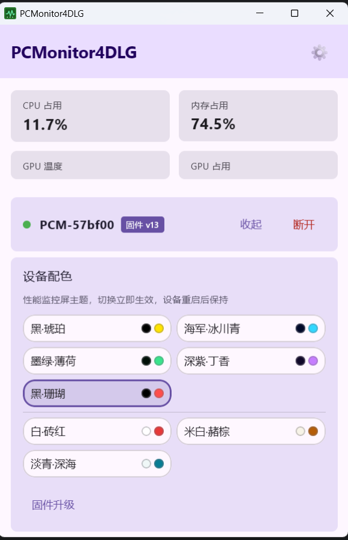

# PCMonitor4DLG

基于 Kotlin Multiplatform (Compose for Desktop) 的 PC 性能监控工具，通过蓝牙将主机硬件状态实时同步至 DA14585 蓝牙时钟设备（DLG 系列）显示。

## 功能介绍



### 实时系统监控

应用主界面实时展示以下主机状态信息（刷新间隔 1 秒）：

- **CPU 占用率**
- **内存占用率**
- **GPU 温度**
- **GPU 占用率**
- **网络上行 / 下行速率**（自动适配 B/s、KB/s、MB/s、GB/s）

### 蓝牙设备连接

- 启动后自动最小化到系统托盘运行
- 点击底部蓝牙状态栏时先检查系统蓝牙开关：未开启则弹窗提示打开蓝牙，开启后才进入设备选择
- 弹窗支持扫描 BLE 设备，可勾选"只显示 PCM 开头的设备"过滤目标设备
- 扫描列表中 DLG 设备会显示其广播的固件版本号（如 `固件 v9`）
- 连接成功后底部状态栏显示设备名与固件版本徽章，自动重连与 OTA 升级后版本号自动更新
- 连接建立时从设备 GATT（0xFF01，`'VER'`魔数）读取实际固件版本，线刷/降级后不会显示残留旧版本号
- 子进程内缓存 GATT 服务表（重复连接跳过服务发现）并复用扫描得到的设备对象，重连更快
- 连接成功后自动开始数据同步（每秒一次），并同步 PC 选中的设备配色

### 启动时自动连接设备

在设置中开启"启动时自动连接设备"后：

- 应用启动时自动尝试连接上一次成功连接的蓝牙设备
- 连接失败时每隔 30 秒自动重试，直到连接成功
- 关闭该开关后立即停止自动重连

### OTA固件升级

设备连接后，蓝牙状态栏出现"升级"按钮，点击可对设备做无线固件升级：

- 选择固件工程（`TFTMonitor`）编译后自动拷贝到桌面的 `tft_monitor_ota_<日期>_v<N>.bin`（**必须带 `_ota_`**；误选整刷镜像会被识别并明确提示）
- 选中即校验（文件大小 + 版本魔数），显示固件版本
- 逐包有响应传输（0xA0 起始 / 0xA2+0xA3 分页 / 0xA4 结束），弹窗显示进度；设备端按需擦除（写各页前按序擦所在扇区），起始命令即时返回
- 完成后设备自行重启（连接断开属正常），升级弹窗在进度到 100% 后自动关闭；重新连接即运行新版本
- 传输期间暂停性能数据同步，设备屏幕冻结属正常；中途失败自动断开恢复设备状态，可重试

### 设备配色主题

"更多"面板提供 8 套预设主题（深色系 5 套 + 浅色系 3 套，分隔线区分），每项带背景色/强调色预览色块：

- 点击即切换，设备整屏重绘并持久化（重启保持）
- **配色以 PC 端为权威**：选择主题实际下发 RGB565 颜色三元组（0xB2），调色只需改 PC 端色表，固件无需重刷
- 发送在后台线程执行，连点不卡 UI；最后点击胜出

### 系统托盘

- 最小化后应用在系统托盘运行，不占用任务栏
- 托盘图标支持双击恢复窗口、右键菜单退出

### 退出行为

点击窗口关闭按钮时弹出退出确认弹窗，提供两个选项：

- **最小化到托盘**：窗口隐藏，应用继续在后台运行
- **退出应用**：彻底关闭应用进程

弹窗可勾选"不再询问，记住我的选择"。

## 环境要求

- Windows 10/11
- 蓝牙适配器（支持 BLE 4.0+）

> BLE 服务以 PyInstaller 打包的 `ble_service.exe` 随应用分发，目标机器**无需安装 Python 和 bleak**。Python 仅在开发时需要（见下文"BLE 服务子进程"）。

## 安装与运行

### 运行应用

```bash
./gradlew :desktopApp:run
```

### 打包

```bash
./gradlew :desktopApp:packageDistribution
```

## BLE 服务子进程

BLE 通信由 `shared/src/jvmMain/resources/ble_service.py`（基于 `bleak` 库）以子进程方式提供，与主程序通过 stdin/stdout JSON 行协议交互。启动优先级：

1. **打包模式**：优先使用资源中的 `ble_service.exe`（PyInstaller 单文件产物，自带 Python 运行时和 bleak）
2. **开发回退**：exe 不存在或启动失败时，回退用系统 `python` 运行 `ble_service.py`（此时需要 `pip install bleak`）

`ble_service.exe` 是 9MB 二进制产物，**不入 git**：构建/打包时由 gradle 自动调用 `tools\build_ble_exe.cmd`（PyInstaller）生成到 `shared/build/generated/ble-exe/` 并挂入打包资源。修改 `ble_service.py` 后直接重新构建即可，gradle 检测到 py 变化会自动重新生成 exe；也可手动执行 `tools\build_ble_exe.cmd`（需已安装 Python + pyinstaller）。

> 注意：PyInstaller 单文件 exe 每次启动时会自解压到临时目录，个别杀毒软件可能误报；如遇此问题可改用 `--onedir` 或对 exe 签名。

## 项目结构

```
├── desktopApp/          # 桌面应用入口
│   └── src/main/kotlin/ # main.kt、窗口与托盘管理
├── shared/              # 共享代码
│   ├── src/commonMain/  # 跨平台代码（UI、ViewModel 接口、数据模型）
│   └── src/jvmMain/     # JVM 平台实现（BLE 管理、系统监控、设置存储）
│       └── resources/   # ble_service.py（BLE 服务子进程；exe 构建时自动生成，不入git）
└── tools/               # 构建辅助脚本（build_ble_exe.cmd）
```

## 技术栈

- Kotlin Multiplatform + Compose Multiplatform (Desktop JVM)
- BLE 通信：Python `bleak` 库（PyInstaller 打包为 exe 后通过子进程调用）
- 系统监控：JNA / OSHI
- 设置持久化：`java.util.prefs.Preferences`
- 开机自启：Windows 注册表写入
